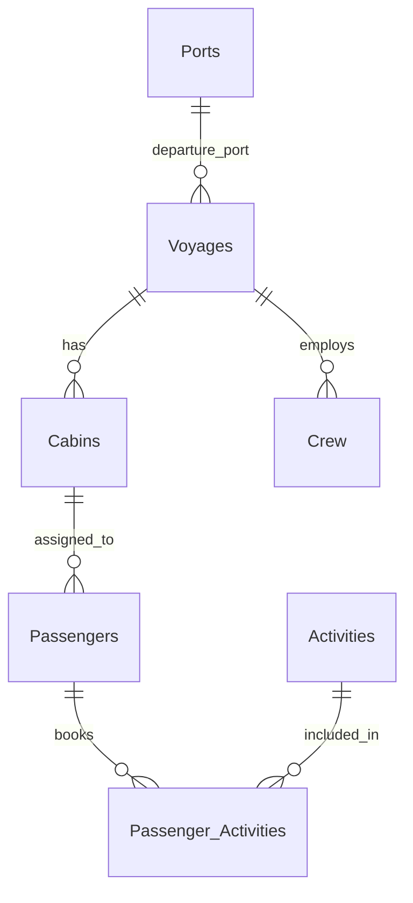

# CruiseShipDB — Database Guide

## 1. Overview

**CruiseShipDB** is a Microsoft SQL Server (T-SQL) practice database for managing cruise voyages, departure ports, cabins, passengers, crew, and onboard activities. It contains **7 related tables** and demonstrates primary keys, foreign keys, data-validation constraints, and a many-to-many relationship.

> **Note:** The SQL creation scripts define the database and its tables; records are added separately using `INSERT` statements. The sample data is fictional.

## 2. Database storage (Part A)

The database is configured with four physical files:

| File | Type | Initial size | Maximum size | Growth |
|---|---|---:|---:|---:|
| `CruiseShipDB_Primary.mdf` | Primary data | 10 MB | 100 MB | 5 MB |
| `CruiseShipDB_Secondary.ndf` | Secondary data (`SecondaryFG`) | 10 MB | 100 MB | 5 MB |
| `CruiseShipDB_Log1.ldf` | Transaction log | 5 MB | 50 MB | 5 MB |
| `CruiseShipDB_Log2.ldf` | Transaction log | 5 MB | 50 MB | 5 MB |

- **Data files** store database objects and data; **log files** record changes for transaction recovery.
- All files use the path `C:\SQLData\`. That directory must exist and be writable by the SQL Server service.
- The secondary filegroup is defined but the tables do not explicitly target it; normally, they are created on the default primary filegroup.

## 3. Tables and columns (Parts B–C)

**PK** = primary key; **FK** = foreign key. All IDs listed as PKs use `INT IDENTITY(1,1)` and are generated automatically.

| Table | Purpose | Columns |
|---|---|---|
| **Ports** | Departure port details | `PortID` **PK**, `PortName`, `Country`, `DockingFee` |
| **Voyages** | Cruise trip details | `VoyageID` **PK**, `VoyageCode`, `DepartureDate`, `ReturnDate`, `VoyageStatus`, `DeparturePortID` **FK** |
| **Cabins** | Cabins assigned to voyages | `CabinID` **PK**, `CabinNumber`, `CabinType`, `PricePerNight`, `VoyageID` **FK** |
| **Passengers** | Passenger information | `PassengerID` **PK**, `First_name`, `Last_name`, `Reg_date`, `Email`, `PassportNo`, `CabinID` **FK** |
| **Crew** | Staff assigned to voyages | `CrewID` **PK**, `FullName`, `RoleTitle`, `Salary`, `HireDate`, `VoyageID` **FK** |
| **Activities** | Onboard activities | `ActivityID` **PK**, `ActivityName`, `LocationOnDeck`, `Cost` |
| **Passenger_Activities** | Activity bookings | `BookingID` **PK**, `PassengerID` **FK**, `ActivityID` **FK**, `BookingDate`, `TicketsCount` |

## 4. Relationships

A **primary key (PK)** uniquely identifies a row. A **foreign key (FK)** references a key in another table and prevents referencing a nonexistent parent record.

| Parent → Child | Relationship | Linking columns |
|---|---|---|
| Ports → Voyages | One-to-many (1:M) | `Ports.PortID` → `Voyages.DeparturePortID` |
| Voyages → Cabins | One-to-many (1:M) | `Voyages.VoyageID` → `Cabins.VoyageID` |
| Cabins → Passengers | One-to-many (1:M) | `Cabins.CabinID` → `Passengers.CabinID` |
| Voyages → Crew | One-to-many (1:M) | `Voyages.VoyageID` → `Crew.VoyageID` |
| Passengers → Passenger_Activities | One-to-many (1:M) | `Passengers.PassengerID` → `Passenger_Activities.PassengerID` |
| Activities → Passenger_Activities | One-to-many (1:M) | `Activities.ActivityID` → `Passenger_Activities.ActivityID` |

**Many-to-many (M:N):** Passengers ↔ Activities is implemented through `Passenger_Activities`. A passenger may book multiple activities, and an activity may have multiple passengers. `PassengerID` and `ActivityID` are allowed to repeat in the linking table; `BookingID` is unique.



*Diagram note:* These symbols show how many child rows are permitted by the foreign keys, not that a parent must already have children.

## 5. Constraints and rules

| Type | How it is used |
|---|---|
| **PRIMARY KEY** | 7 keys — one per table; every record has a unique ID. |
| **FOREIGN KEY** | 6 keys — connect the tables and enforce referential integrity. |
| **UNIQUE** | `Ports.PortName`, `Voyages.VoyageCode`, `Cabins.CabinNumber`, `Passengers.Email`, and `Passengers.PassportNo` cannot duplicate existing values. |
| **CHECK** | `DockingFee >= 0`; valid voyage statuses; valid cabin types; `PricePerNight > 0`; `Salary > 0`; `Activities.Cost >= 0`; `TicketsCount >= 1`. |
| **DEFAULT** | Voyage status = `'Scheduled'`; passenger registration date = current server date; activity cost = `0.00`; booking date = current server date. |
| **NOT NULL** | Required fields must not be left NULL. |

**Allowed statuses:** `Scheduled`, `Active`, `Completed`, `Cancelled`.

**Allowed cabin types:** `Inside`, `OceanView`, `Balcony`, `Suite`.

## 6. How to run the project

1. Open **SQL Server Management Studio (SSMS)** and connect to Microsoft SQL Server.
2. Ensure `C:\SQLData\` exists and SQL Server can access it.
3. Run the database-creation script **by itself**. SQL Server requires `CREATE DATABASE` to be in its own batch.
4. Select the database with `USE CruiseShipDB;` (execute that first), then run the table-creation script.
5. Insert sample data **in this order** to satisfy foreign keys: **Ports → Voyages → Cabins → Passengers → Crew → Activities → Passenger_Activities**. Crew and Activities can also be inserted earlier once their dependencies exist.
6. Run `SELECT` queries to confirm the records and test the relationships.

**Warning:** The optional reset script drops the entire existing database and all its data. Do not run it unless you intend to start over.

## 7. Useful SQL commands

```sql
-- Show all user tables (run while using CruiseShipDB)
SELECT name FROM sys.tables ORDER BY name;

-- Display every port
SELECT * FROM Ports;

-- Add a port (PortID is generated automatically)
INSERT INTO Ports (PortName, Country, DockingFee)
VALUES ('New Port', 'Egypt', 1000.00);

-- Find expensive cabins
SELECT CabinNumber, CabinType, PricePerNight
FROM Cabins
WHERE PricePerNight > 2000
ORDER BY PricePerNight DESC;

-- Show each voyage's departure port
SELECT V.VoyageCode, P.PortName
FROM Voyages AS V
JOIN Ports AS P ON V.DeparturePortID = P.PortID;

-- Show passengers and their booked activities
SELECT P.First_name, P.Last_name, A.ActivityName, PA.TicketsCount
FROM Passenger_Activities AS PA
JOIN Passengers AS P ON PA.PassengerID = P.PassengerID
JOIN Activities AS A ON PA.ActivityID = A.ActivityID;

-- Count passengers per cabin
SELECT CabinID, COUNT(*) AS PassengerCount
FROM Passengers
GROUP BY CabinID;
```

`SELECT` reads data; `INSERT` adds rows; `UPDATE` changes rows; `DELETE` removes rows. Use a `WHERE` clause with `UPDATE` or `DELETE` when you intend to change only specific records.

## 8. Current design limitations

- `CabinNumber` is unique across the **entire database**, so two voyages cannot reuse the same cabin number. A more realistic system would model physical **Ships** and their cabins separately.
- The database does **not** check whether `ReturnDate` is after `DepartureDate`.
- It does **not** enforce cabin capacity or prevent repeated bookings of the same passenger/activity combination.
- Activity bookings are not directly tied to a specific voyage.

These are suggested future improvements, not missing constraints from the original assignment.

---

**Project summary:** 7 tables, 7 primary keys, 6 foreign keys, 5 unique constraints, 7 check constraints, and 4 defaults. Its key learning objective is to understand how related SQL Server tables store consistent data using keys, constraints, and `JOIN` queries.
